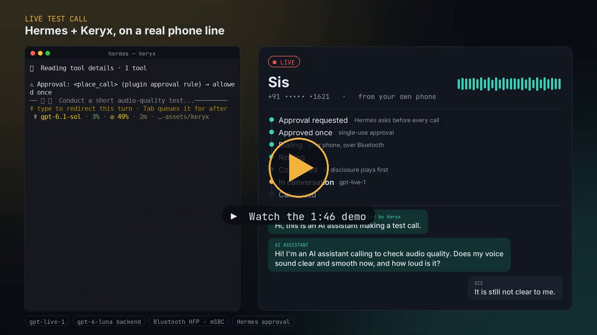

<p align="center">
  
</p>

# Keryx

**Your Hermes agent makes real phone calls, from your own phone.**

Keryx is a [Hermes Agent](https://github.com/NousResearch/hermes-agent) plugin. You tell Hermes what a
call should achieve; Hermes writes a brief and asks you to approve the call; your phone dials over
Bluetooth (the laptop acts as a hands-free car kit) and a realtime voice model holds the conversation.
When the call ends, the outcome, details and transcript go back to Hermes, which can act on them.

No Twilio. No telephony account. Your SIM, your number.

<p align="center">
  <a href="assets/keryx-demo.mp4"></a>
  <br>
  <sub><a href="assets/keryx-demo.mp4">Watch the demo (1:46)</a>: a live test call placed through Hermes, start to finish.</sub>
</p>

## How it works

```
You ─► Hermes ─► place_call ─► approval ─► guardrails ─► your phone dials (Bluetooth HFP)
                                                              │
                     realtime voice model ◄── audio bridge ◄──┘ ◄── the person you called
                              │
                      ask_principal ─► Hermes model + read-only tools, else asks you
                              │
                         end_call ─► outcome + transcript back to Hermes
```

1. **Ask Hermes**: "Call Looks Salon on +91 98123 45678 and book a haircut for Saturday morning, max ₹600."
2. **Approve**: Hermes shows the number, goal and limits and asks you. Every call needs its own approval.
3. **Your phone dials**: Keryx drives your paired phone over Bluetooth through PipeWire's telephony API.
4. **The AI holds the call**: the plugin plays an AI-disclosure line, then a realtime voice model talks.
   If it needs a decision it can't make from the brief, it asks you (`ask_principal`) mid-call.
5. **Outcome to Hermes**: status, summary, details (prices, times, reference numbers), follow-ups and the
   transcript. `/calls` lists recent calls.

## Safety, enforced in code

- **Approval before every call.** A `pre_tool_call` hook routes each `place_call` through Hermes's approval
  prompt. The handler dials only arguments the hook saw, and an approval is good for one call
  ("always" never carries over).
- **Blocked numbers.** Emergency and public-service numbers (112, 911, 100, 108…), anything under 7 digits,
  `*`/`#` codes and premium-rate prefixes never dial. Optional allow and block lists.
- **Quiet hours and a rate limit.** No calls 21:00–09:00 by default; at most 6 calls an hour.
- **Five-minute hard cap.** The model gets a wrap-up warning 30 seconds before the end, then the plugin
  hangs up. `/stop` in Hermes also hangs up.
- **AI disclosure from the plugin.** The disclosure is rendered before dialing (no disclosure, no call) and
  played as soon as the call connects. The model hears nothing from the callee until it has finished.
- **Honest outcomes.** If the model doesn't report an outcome, one is written from the transcript after
  hang-up, marked as such.
- **Touch tones** are limited to `0-9 * #`; the mid-call resolver may only use tools you list in
  `readonly_tools`.

## Requirements

- Linux with **PipeWire ≥ 1.4** and WirePlumber (native HFP backend). Tested on PipeWire 1.6.
- A phone paired over Bluetooth with **phone calls** allowed for the computer (Android or iPhone).
- **Hermes Agent ≥ 0.23**.
- An **OpenAI API key** (realtime voice model and the disclosure line).

## Install

```bash
hermes plugins install hsyvy/keryx#keryx
```

```bash
hermes plugins enable keryx
```

```bash
hermes keryx doctor
```

`doctor` checks the key, the PipeWire tools, the telephony service and whether a phone line is ready.
Make the OpenAI key available to Hermes as `OPENAI_API_KEY` (Hermes's secrets), and set your name:

```yaml
# ~/.hermes/config.yaml
plugins:
  entries:
    keryx:
      settings:
        principal_name: "Asha"          # callees hear "calling on behalf of Asha"
```

### Pair your phone

The laptop acts as a Bluetooth hands-free unit for the phone.

1. Make sure WirePlumber runs the native HFP backend with the hands-free role. If `hermes keryx doctor`
   reports no phone line after pairing, add `~/.config/wireplumber/wireplumber.conf.d/80-keryx-hfp.conf`:

   ```
   monitor.bluez.properties = {
     bluez5.hfphsp-backend = "native"
     bluez5.roles = [ a2dp_sink a2dp_source hsp_hs hsp_ag hfp_hf hfp_ag ]
   }
   ```

   then restart WirePlumber:

   ```bash
   systemctl --user restart wireplumber
   ```

2. Pair and connect the phone (GNOME Settings → Bluetooth, or `bluetoothctl`). On Android, turn on
   **Phone calls** for this computer in the phone's Bluetooth settings.
3. Run `hermes keryx doctor` until it shows `phone line: ready`. With more than one phone connected, set
   `bluetooth_device` to your phone's address.

No phone handy? Set `transport: speakerphone`: you dial by hand with the phone on speaker next to the laptop.

## Use

In Hermes (terminal, Telegram or Desktop):

> Call Looks Salon on +91 98123 45678 and book a haircut for Saturday morning, max ₹600.

- `/calls` lists recent calls; `/calls <id>` shows one with its transcript.
- `hermes keryx calls` and `hermes keryx show <id>` do the same from the shell.
- `hermes keryx simulate` runs a whole fake call: no phone, no API key.

## Voice engines

| `voice_engine` | Model | Notes |
|---|---|---|
| `openai-realtime` (default) | `gpt-realtime` or any `gpt-realtime-*` (`realtime_model`) | The voice model calls Keryx's functions itself. |
| `openai-live` | GPT-Live, `gpt-live-1` (`live_model`) | Full duplex, handles interruptions itself, faster turns. Tools run through a backend model (`live_backend_model`, default `gpt-5.4-mini`). |

GPT-Live has no tools of its own, so Keryx adds code-level guards: a backend `end_call` is refused unless
someone said goodbye (or the time warning went out, or it's voicemail); goodbye watchdogs end the call if
the model forgets to; anything said after hanging up is muted.

## Settings

All under `plugins.entries.keryx.settings` (the Desktop settings form shows them too).

| Setting | Default | |
|---|---|---|
| `principal_name` | — | Your name, as the assistant introduces you. |
| `transport` | `bluetooth-linux` | Or `speakerphone`. |
| `voice_engine` | `openai-realtime` | Or `openai-live`. |
| `voice` | `marin` | Voice for the call and the disclosure line. |
| `disclosure_text` | `Hi, this is an AI assistant calling on behalf of {principal}.` | Played by the plugin. Mention recording here if you turn it on. |
| `default_country_code` | `+91` | Used when a number has no leading `+`. |
| `max_call_seconds` | `300` | Can be lowered, never raised above 300. |
| `quiet_hours` | `21:00-09:00` | Local time; empty disables. `timezone` overrides the system zone. |
| `max_calls_per_hour` | `6` | |
| `allowed_numbers` / `blocked_numbers` | `[]` | E.164 numbers or prefixes. |
| `readonly_tools` | `[]` | Hermes tools the mid-call resolver may use (e.g. a calendar lookup). |
| `record` | `false` | Save both sides as WAV next to the call log. |
| `bluetooth_device` | — | Phone's Bluetooth address when several are connected. |
| `telephony_bus` | `user` | `user` for PipeWire's telephony service, `system` for oFono. |

## What Keryx touches

- **Network:** OpenAI only: `wss://api.openai.com/v1/realtime` or `wss://api.openai.com/v1/live/sessions`
  (call audio both ways), `https://api.openai.com/v1/audio/speech` (the disclosure line, rendered once and
  cached) and, with GPT-Live, one `https://api.openai.com/v1/responses` request after a call when an
  outcome has to be written from the transcript.
- **Your phone:** places real calls on your SIM, at your normal call rates.
- **Shell commands:** `busctl`, `pw-dump`, `pw-record`, `pw-play`, `pw-link`, `pw-cli` (two temporary
  virtual audio nodes during a call) and `espeak-ng` as an offline fallback for the disclosure line.
- **Background work:** only during a call you approved. Nothing listens otherwise.
- **Storage:** `<HERMES_HOME>/plugin-data/keryx/`: call log (SQLite), cached disclosure audio, recordings
  when `record: true`.
- **Credentials:** `OPENAI_API_KEY` through Hermes's secret store only.

Calling people with an AI voice is regulated in many places, and recording calls usually needs consent.
Keep the disclosure on, mention recording if you enable it, and check the rules where you and the people
you call are.

## Troubleshooting

| Symptom | Fix |
|---|---|
| `phone line: no phone connected` | Pair and connect the phone, allow phone calls for the computer, check the WirePlumber config above. |
| Call connects but nobody hears the assistant | Run `hermes keryx doctor`; make sure no other app holds the Bluetooth call audio. |
| Choppy audio on some adapters | Try forcing narrowband: `bluez5.enable-msbc = false` in the WirePlumber config. |
| Call refused | The error says why: quiet hours, rate limit, blocked number, or the approval was declined. |

## Development

```bash
python3 -m pytest -q
```

The tests use a fake phone, a scripted voice model, a fake telephony D-Bus, fake Realtime and GPT-Live
sockets and recorded PipeWire node dumps, so CI needs no hardware and no API key.

```
keryx/
  __init__.py          register(ctx): tool, hooks, /calls, `hermes keryx`
  tools.py             place_call, approval hook, /stop hook, notifications
  brief.py             brief compiler and voice-model instructions
  guardrails.py        number checks, quiet hours, rate limit
  orchestrator.py      call state machine
  audio.py             resampling, pacing, recording
  resolver.py          mid-call questions to you
  disclosure.py        disclosure line (WAV, OpenAI TTS, espeak-ng)
  calllog.py           SQLite call log
  transport/           bluetooth-linux, speakerphone, PipeWire helpers
  voice/               openai_realtime.py, openai_live.py
  testing.py           fake phone + scripted voice for tests and `simulate`
tests/
```

Planned: Windows (Phone Link) and macOS (Continuity) transports, Gemini Live and Indic voice adapters,
inbound call screening.

## License

MIT
